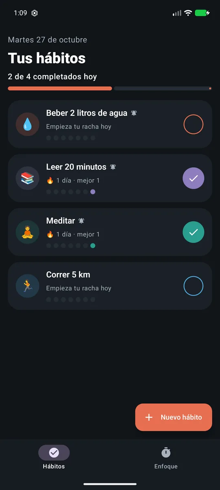
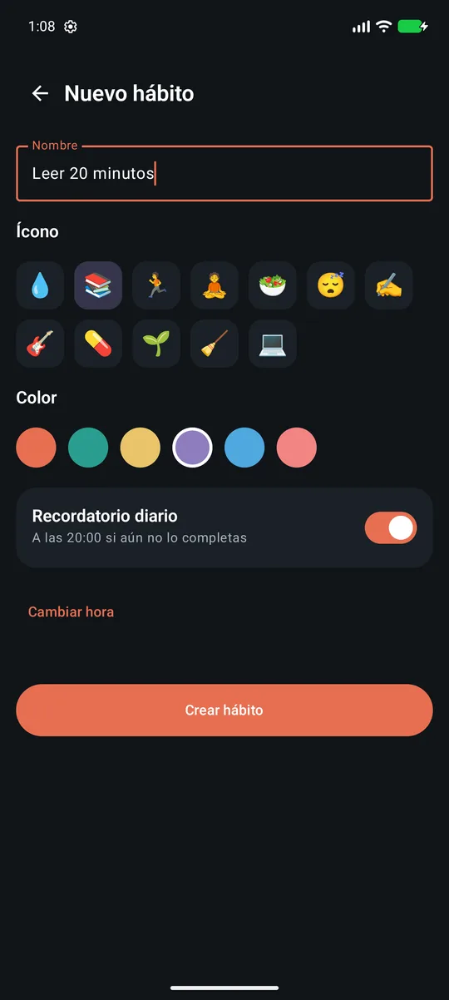
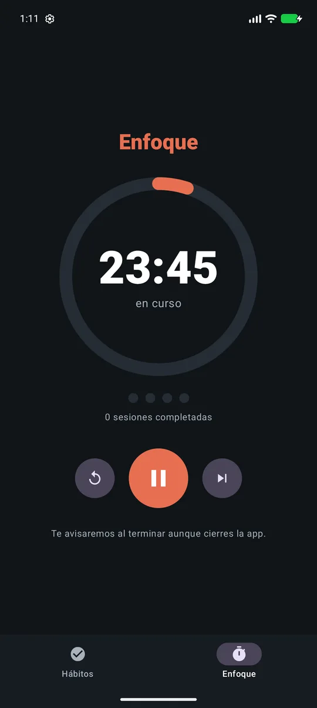

# Enfoca ⏱️

App Android de **productividad**: un **rastreador de hábitos** con rachas y recordatorios diarios, y un
**temporizador Pomodoro** que avisa al terminar cada fase aunque la app esté cerrada. Pensada para
demostrar trabajo en segundo plano confiable, notificaciones con canales, animaciones en Compose y
pruebas en todos los niveles.


| Hábitos | Nuevo hábito | Pomodoro |
|:---:|:---:|:---:|
|  |  |  |

---

## Tabla de contenido

- [Qué problema resuelve](#qué-problema-resuelve)
- [Funcionalidades](#funcionalidades)
- [Stack tecnológico](#stack-tecnológico)
- [Arquitectura](#arquitectura)
- [Trabajo en segundo plano](#trabajo-en-segundo-plano)
- [Pruebas](#pruebas)
- [Compilar y ejecutar](#compilar-y-ejecutar)

## Qué problema resuelve

Crear un hábito depende de recordarlo cada día y de ver el progreso. Enfoca recuerda solo los hábitos
que **aún no** se han hecho ese día, muestra la racha para motivar a no romperla y acompaña las
sesiones de trabajo con la técnica Pomodoro.

## Funcionalidades

- ✅ **Hábitos** con ícono, color y **recordatorio diario** opcional (selector de hora Material 3).
- 🔥 **Rachas**: actual (no se rompe hasta que termina el día), mejor racha y los últimos 7 días.
- 📊 Progreso del día animado y check con animación de rebote (`AnimatedVisibility`, `spring`).
- 🍅 **Pomodoro** 25/5 min con descanso largo de 15 min cada 4 sesiones; pausar, reiniciar y saltar.
- 🔔 **Notificaciones locales** en dos **canales** (recordatorios y temporizador) para silenciarlos por separado;
  tocar la del temporizador abre la pestaña de Enfoque.
- 💾 El temporizador **sobrevive al cierre de la app**: se guarda la hora de fin, no un contador.
- 🧭 Navigation Compose con barra inferior y transiciones personalizadas entre pantallas.

## Stack tecnológico

| Área | Tecnología |
|------|------------|
| Lenguaje | Kotlin 2.0, Coroutines, Flow, `java.time` |
| UI | Jetpack Compose, Material 3, Navigation Compose, animaciones de Compose, Canvas |
| Arquitectura | Clean Architecture (data / domain / presentation) + MVVM |
| DI | Hilt (incluido `@HiltWorker` para WorkManager) |
| Segundo plano | WorkManager (recordatorios), AlarmManager (fin de cada Pomodoro), BroadcastReceiver |
| Persistencia | Room (hábitos y días completados), DataStore (estado del temporizador) |
| Pruebas | JUnit 4, MockK, kotlinx-coroutines-test, Compose UI Testing |

## Arquitectura

```
presentation   HabitsScreen · HabitEditorScreen · FocusScreen  (+ ViewModels con StateFlow)
                    │
domain         Streaks · PomodoroRules            (reglas puras, sin Android)
               SaveHabit · DeleteHabit · ToggleHabit · PomodoroController (casos de uso)
               HabitRepository · PomodoroRepository · ReminderScheduler   (interfaces)
                    ▲
data           Room (HabitDao) · PomodoroStore (DataStore)
               AndroidReminderScheduler ─┬─ WorkManager → HabitReminderWorker
                                         └─ AlarmManager → PomodoroAlarmReceiver → Notifications
```

`ReminderScheduler` es una interfaz del dominio: los casos de uso no saben si detrás hay WorkManager o
AlarmManager, y en las pruebas se reemplaza con MockK.

## Trabajo en segundo plano

| Necesidad | Herramienta | Por qué |
|-----------|-------------|---------|
| Recordatorio diario de cada hábito | `PeriodicWorkRequest` único por hábito (24 h, retraso inicial hasta la hora elegida) | Sobrevive a reinicios y actualizaciones; no necesita exactitud al segundo. El *worker* solo notifica si el hábito sigue pendiente. |
| Fin de un Pomodoro | `AlarmManager.setExactAndAllowWhileIdle` | Debe sonar a tiempo incluso en Doze. Usa `USE_EXACT_ALARM` (apps de temporizador, Android 13+) y cae a una alarma inexacta si no hay permiso. |
| Estado del temporizador | DataStore con la **hora de fin** | Si el sistema mata el proceso, al volver el tiempo restante se recalcula con el reloj. |

El permiso `POST_NOTIFICATIONS` se pide en tiempo de ejecución (Android 13+), y WorkManager se
inicializa desde `EnfocaApp` con `HiltWorkerFactory` para inyectar repositorios en los *workers*.

## Pruebas

```bash
./gradlew :app:testDebugUnitTest            # 13 pruebas unitarias
./gradlew :app:connectedDebugAndroidTest    # 2 pruebas de UI (emulador o dispositivo)
```

- **`StreaksTest`**: racha actual, que hoy pendiente no rompe la racha, mejor racha, últimos 7 días.
- **`PomodoroRulesTest`**: pausar/reanudar conserva el tiempo, descanso largo cada 4 sesiones, formato del reloj.
- **`UseCaseTest`** (MockK): guardar un hábito programa el recordatorio con el id nuevo, sin hora lo cancela,
  nombre vacío no toca la base de datos, iniciar el temporizador programa la alarma y pausar la cancela.
- **`HabitCardTest`** (Compose UI Testing): muestra la racha y al tocar el check la actualiza.

## Compilar y ejecutar

Requisitos: Android Studio (Ladybug o superior), JDK 17, Android SDK 35.

```bash
./gradlew :app:assembleDebug
adb install -r app/build/outputs/apk/debug/app-debug.apk
```

---

Desarrollado por **Adrián Alvarez** ([@Cordobot](https://github.com/Cordobot)).

© 2026 Adrián Alvarez. Todos los derechos reservados.
